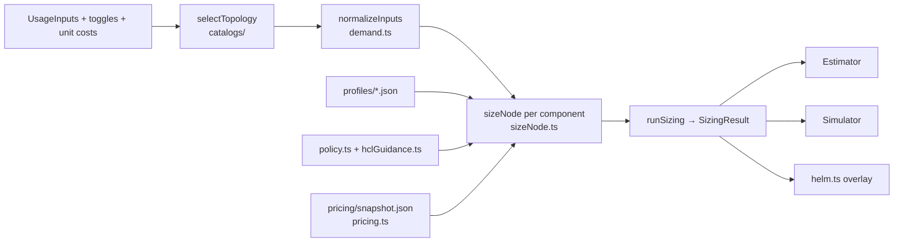

# DX Sizing Tool — Specification

> **Status:** living spec, source of truth for the sizing model. Last updated 2026-11-17.
> Supersedes the original design plan (`~/.cursor/plans/dx_sizing_simulator_0c1fbcda.plan.md`, 2026-11-11), which is kept unchanged as history.
> Estimation aid only — not an HCL official sizing (SCU), guarantee or quote.

## 1. Purpose

Turn business and usage inputs into a sized, costed HCL DX deployment for **DXCN** (Core) or **DX Compose** (webEngine). It has two views, both driven by one engine:

| Surface | Job |
|---|---|
| **Estimator** | Bill of materials (BOM): replicas, CPU, memory, storage, utilization, cost, sessions, AI tokens. Exports JSON, CSV and a Helm values overlay. |
| **Simulator** | Topology graph with RPS on edges and colour-coded utilization. Load slider, scenario presets, manual add/remove replicas. |
| **Calibrate** | Turn Locust measurements into a lab-calibrated capacity profile. |
| **Live vs est** | Compare `kubectl top pods` with the estimate. |

**Success criteria**

1. The same inputs give the same numbers in the Estimator and in the Simulator node panel (both call `runSizing()`).
2. Switching products changes the graph and removes illegal nodes: no Remote Search on Compose, no webEngine on DXCN.
3. Each formula in §6 has a unit test (`src/engine/engine.test.ts`).

## 2. Architecture



| Module | Responsibility |
|---|---|
| `src/engine/runSizing.ts` | Orchestration, replica overrides, cost totals, warnings |
| `src/engine/demand.ts` | Inputs → RPS per traffic class, sessions, storage, tokens, egress |
| `src/engine/sizeNode.ts` | Replicas / CPU / memory / storage / util / p95 per component; edge RPS |
| `src/engine/policy.ts` | **Tool assumptions** (availability floors, uncertainty, queueing) |
| `src/engine/hclGuidance.ts` | **HCL-sourced** figures (pod shape, rendering mix) plus session-heap assumptions |
| `src/profiles/*.json` | Capacity constants per component, tagged by CF release |
| `src/catalogs/` | Product topology and toggle forcing |
| `src/engine/helm.ts` | `hcl-dx-deployment` values overlay |
| `src/engine/pricing.ts` | Unit prices from the committed price snapshot; tiered egress; discounts |
| `src/pricing/snapshot.json` | Public cloud list prices by provider / region, written by `scripts/fetch-pricing.mjs` |

The engine is pure TypeScript with no UI dependencies and runs in the browser. There's no backend. Prices are never fetched at runtime; the site reads the committed snapshot.

## 3. Topology rules

- **Pages:** CDN miss → (production: WAF → cloud LB) → HAProxy → Core / webEngine.
- **DAM assets:** HAProxy → DAM directly (`/dx/api/dam/…`), never through Core / webEngine. DAM → image processor (20%) and → persistence connection pool → persistence node.
- **Auth:** browser → external IdP redirect; Core / webEngine → IdP back-channel (token / JWKS) and → OpenLDAP binds. Neither goes through HAProxy.
- **IQ:** HAProxy → IQ integrator → MCP. Its own traffic class, never folded into portal RPS.
- **Toggle forcing:** DAM turns on Ring API, image processor, persistence and RWX. Content Composer turns on Ring API. Any Search V2 part turns on the whole trio. IQ turns on MCP.
- **RWX:** always on DXCN (Core shared file system). On Compose only when DAM is on.

## 4. Inputs

Defaults are in `src/engine/defaults.ts`. Inputs that need data from your environment default to **0 = off**, so the tool never shows a number based on made-up data.

| Input | Default | Used for | Status |
|---|---|---|---|
| Peak concurrent users | 5000 | Sessions, RPS | ✅ |
| DAU | 20000 | Sessions/day, tokens, egress, busy-hour fallback | ✅ |
| MAU | 200000 | — | ⚠️ informational only |
| Peak RPS override | 0 | Replaces derived front-door RPS | ✅ |
| Req / session, session duration | 25, 20 min | Session pacing | ✅ |
| Think time | 0 (off) | Load-test (Locust VU) pacing | ✅ |
| % authenticated | 40 | Auth RPS, token overhead | ✅ |
| % anonymous, % form-post | 60, 15 | — | ⚠️ informational / Locust export only |
| % browse, % author | 75, 10 | DB load, Content Composer load | ✅ |
| Search attach, searches/hit | 0.4, 1.5 | Search RPS | ✅ |
| DAM request share | 0 (derive) | DAM share of requests | ✅ |
| DAM attach, assets/page | 0.1, 3 | DAM share when request share = 0 | ✅ |
| Page / DAM cache hit ratio | 0.4 / 0.4 | Origin RPS | ✅ |
| AZ count | 2 | Replica floor | ✅ |
| Target availability | 99.9% | Replica floor and spares (§6.3) | ✅ |
| Target p95 | 800 ms | Latency check (needs a baseline) | ✅ |
| Target CPU / memory / disk util | 0.6 / 0.7 / 0.7 | Headroom (§6.2) | ✅ |
| Busy-hour factor | 4 | Peak users from DAU when peak users = 0 | ✅ |
| Baseline p95 | 0 (off) | Measured low-load page p95 | ✅ |
| Avg page / asset KB | 0 / 0 (off) | Egress | ✅ |
| Auth token overhead KB | 0 (off) | LTPA / JWT session memory | ✅ |
| Growth CAGR, load multiplier | 0.15, 1 | Demand scale, applied once | ✅ |
| Cloud provider, region | AWS, provider default (us-east-1 / eastus / us-central1) | List prices (§6.5) | ✅ (GKE needs the API key) |
| Compute pricing basis | Node-pool VMs | Node-pool fit or serverless rates (§6.5) | ✅ |
| Cloud discount % | 0 | Savings plan / reserved / committed use on cloud spend | ✅ |
| Enterprise discount % | 0 | EDP / MACC-style agreement, on top | ✅ |
| Unit costs (vCPU, GiB, storage, egress) | List prices for the region | Editing any of them switches to custom rates | ✅ |

## 5. Assumption sources

Every constant comes from one of three sources. Keep them separate in code.

| Source | Where | Examples |
|---|---|---|
| **HCL documentation** | `hclGuidance.ts` | Core/webEngine pod 5.6 CPU / 8Gi (req = limit), 4Gi heap Xms = Xmx (CF239 K8s guide); rendering mix WCM 40 / pages 30 / DAM 30 |
| **Design plan** | `defaults.ts` | CPU 0.6 / memory 0.7 / disk 0.7 headroom; busy-hour 4×; session safety ×1.3 |
| **Tool policy** | `policy.ts`, `hclGuidance.ts` | Availability floors; capacity σ 0.25 / 0.1; 50% of heap for sessions; M/M/c latency model |
| **Cloud list prices** | `pricing/snapshot.json` | vCPU-hour, GiB-hour, storage GiB-month, egress tiers per provider / region, with source URL and fetch date |
| **Placeholder** | `profiles/*.json`, `defaults.ts` | `rpsPerReplica`, `cpuPerRps`, … until lab-calibrated; `defaultUnitCosts` (used only for custom rates and providers without snapshot data); AI token price |

## 6. Sizing model

### 6.1 Demand (`demand.ts`)

```text
scale        = loadMultiplier × (1 + CAGR)                       applied once
basePeak     = peakUsers                    if peakUsers > 0
             = DAU × T_session_min / 1440 × busyHourFactor       otherwise
U_peak       = basePeak × scale
pacing       = thinkTime  if > 0  else  T_session_min × 60 / req_per_session
frontDoorRps = override × scale  if override > 0  else  U_peak / pacing
damShare     = damRequestShare  or  a·n / (1 + a·n)              0 when DAM off
portalRps    = frontDoor × (1 − damShare) × (1 − pageCacheHit)   → Core/webEngine
damRps       = frontDoor × damShare × (1 − damCacheHit)          → DAM
originRps    = portalRps + damRps                                WAF / LB / HAProxy (+ IQ)
sessionKbEff = sessionKb + authTokenKb × %authenticated
egressGB/mo  = DAU × 30 × req/session × [(1−s)·pageMiss·pageKb + s·damMiss·assetKb] / 1024²
```

Search, DB, auth, authoring, Ring and IQ RPS fan out from `portalRps` / `damRps` as in `demand.ts`.

### 6.2 Replicas and headroom (`sizeNode.ts`)

```text
loadRep   = ceil( offered / (rpsPerReplica × targetCpuUtil) )
minSafe   = production ? max(haMin, azCount, avail.min) : avail.min
recommend = max(loadRep + avail.spare, minSafe)
memory    = working set / targetMemUtil            (not Core/webEngine)
storage   = base + demand-driven growth / targetDiskUtil
util      = offered / (replicas × rpsPerReplica)   p50
utilP90   = util × e^(1.2816 σ)                    σ = 0.25 default, 0.1 lab-calibrated
```

`rpsPerReplica` is capacity at 100% utilization, which matches how calibration derives it.

**Core / webEngine** use a fixed HCL pod (5.6 CPU, 8Gi, 4Gi heap). The replica count is the largest of:

| Rule | Formula |
|---|---|
| Load | `loadRep` above |
| CPU budget | `ceil(cpuPerRps × RPS / (5.6 × targetCpuUtil − cpuBase))` |
| Session heap | `ceil(U_peak × sessionKbEff × 1.3 / (4Gi × 0.5))` |
| Latency (if baseline p95 > 0) | smallest c with `baselineP95 × (1 + C(c,a)/(c − a)) ≤ targetP95`, a = RPS / rpsPerReplica |

The latency model treats each replica as one M/M/c server and scales the measured low-load p95 by the mean response-time inflation. It's an approximation for comparing options, not a latency prediction. If the baseline is already above the target, replicas can't fix it and the node says so.

### 6.3 Availability policy (`policy.ts`)

| Target | Min replicas | Spare | Production floor (haMin, AZ) |
|---|---|---|---|
| < 99.9% | 1 | 0 | no (lab sizing, warns) |
| 99.9% | 2 | 0 | yes |
| 99.95% | 2 | N+1 | yes |
| 99.99% | 3 | N+1 | yes (warns if AZ < 3) |

### 6.4 Manual overrides

`runSizing({ replicaOverrides })` accepts counts **above or below** the recommendation. They apply only to scalable components and are clamped to ≥ 1. A node keeps `recommendedReplicas` and `minSafeReplicas`. Going below `minSafeReplicas` adds a node note and a result warning. In the Simulator, *Add replica* / *Remove replica* set the override; returning to the recommended count clears it.

### 6.5 Costs (`pricing.ts`, `runSizing.ts`)

```
total = infra·d + egress·d + license + AI tokens + self-host LLM
infra = Σ (CPU·730·$vCPU + GiB·730·$GiB + storage·$storage)
d     = (1 − cloud%) × (1 − enterprise%)          (each clamped to 0–99%)
```

Discounts apply to cloud spend only (infra and egress), never to the DX license, AI tokens or self-hosted LLM. Results carry `cloudListMonth` (before discounts), `cloudDiscountMonth` and `discountFactor`.

**Unit prices.** `resolveUnitCosts(costs, provider, {region, basis, custom})` picks rates from `src/pricing/snapshot.json`:

| Provider | Node-pool VMs (default) | Serverless pods | Storage | Egress |
|---|---|---|---|---|
| AWS (EKS) | Fit over EC2 c6i / m6i / r6i, Linux on-demand | Fargate Linux x86 | EBS gp3 | Internet egress tiers; first 100 GB free |
| Azure (AKS) | Fit over Dlsv5 / Dsv5 / Esv5, Linux pay-as-you-go | Container Instances Standard | Premium SSD v2 capacity | Bandwidth, Microsoft-network routing tiers |
| GKE | N2 core + RAM SKUs | Autopilot pod requests | Balanced PD | Premium-tier internet egress (highest destination rate) |
| OpenShift | AWS rates (ROSA); subscription fee **not** included | | | |

- **Node-pool fit.** `price = a·vCPU + b·GiB`, least squares over 9 shapes (3 families with memory ratios 1:2, 1:4 and 1:8, at 4, 8 and 16 vCPU). `a` and `b` are the per-vCPU and per-GiB rates. Relative RMS error is stored per region (0.1–2.5% in the first snapshot).
- **Egress.** With list prices, each GB is billed at the rate of its tier (`egressCostMonth`). Custom rates use a flat $/GB.
- **Fallbacks.** An unknown region falls back to the provider default. A missing serverless rate falls back to node-pool. A provider without snapshot data uses `defaultUnitCosts` and adds a "placeholder unit costs" warning.
- **Custom rates.** Editing vCPU, GiB, storage or egress in the UI sets `pricing.custom = true`; *Use list prices* switches back.
- **Not modelled:** reserved / spot pricing (use the discount fields), the K8s control-plane fee, node system overhead and bin-packing waste, managed services (DB, Redis, LB, NAT), support, taxes, currency other than USD.

**Snapshot refresh.** `npm run pricing:fetch` (`scripts/fetch-pricing.mjs`) pulls:

| Provider | Source | Login |
|---|---|---|
| AWS | Price List bulk offer files (`AmazonECS`, `AmazonEC2` CSV streamed, `AWSDataTransfer`) | None |
| Azure | Retail Prices API | None |
| GCP | Cloud Billing Catalog API | API key in `GCP_PRICING_API_KEY` |

Rates outside sanity bounds are rejected per region. A provider that fails keeps its previous data and the script exits 1. Unchanged data produces no file diff. `--provider aws|azure|gke` limits a run; `--dry-run` prints to stdout.

## 7. Outputs

- **SizedNode:** replicas, recommendedReplicas, minSafeReplicas, scalable, offered/capacity RPS, util, utilP90, p95Ms (portal runtime), CPU, memory, storage, cost, notes.
- **Helm overlay** (`helm.ts`): `scaling.replicas.<chart name>` and `resources.<chart name>` for `hcl-dx-deployment`, verified against CF233 and CF237 `values.yaml`. Requests equal limits. Search V2 / DX IQ / People Service appear as comments. Includes a JVM heap note.
- **CSV:** adds recommended replicas, util p90 and p95.

## 8. Calibration

`rpsPerReplica ≈ observed_rps / replicas / util` and `cpuPerRps ≈ (cpu/replica − cpuBase) / rps-per-replica`. `cpuBase` is idle CPU, not the HCL pod size. Calibrated profiles register as `<id>-lab` with `confidence: lab-calibrated`, which narrows the p90 range.

## 9. Backlog

| ID | Item | Notes |
|---|---|---|
| B3 | Route Ring API / Content Composer as HAProxy → CC / Ring → Core | Currently Core → them |
| B4 | Optional DAM proxy (Apache / Nginx) cache tier | The lab runs one with HPAs |
| B5 | Make "DX DB primary" optional | No external DB in the lab values |
| B6 | Split Search V2 into manager/data and query/data nodes | Matches the lab charts |
| C5 | Rename / re-anchor `dxcn-cf238` | The lab runs CF233 (CF235 upgrade scripted) |
| C6 | Sticky sessions follow the authenticated share | Chart default `alwaysEnableSessionAffinity: false` |
| C7 | HPA min/max/target in the Helm overlay | Lab-mode replicas are done (availability < 99.9%) |
| C8 | Model Compose RWX profile and search volumes | |
| C9 | Extend the live-compare pod name map | Persistence and search middleware pods are missed |
| D1 | Calibrate profiles from a real Locust + `kubectl top` run | All profiles are still `default` |
| A7 | Use or remove MAU, % anonymous, % form-post | Informational only today |
| S1 | Carry Simulator overrides into the Estimator and exports | Overrides are Simulator-local state |
| P1 | GKE list prices | Code path written but untested: needs `GCP_PRICING_API_KEY` |
| P2 | Scheduled price refresh (GitHub Action → PR) | Needs repo-owner approval: the job needs `contents: write` and `pull-requests: write` |
| P3 | Managed-service cost lines (DB, Redis, LB, NAT, control plane) | Platform nodes are sized as pods today |

## 10. Decision log

| Date | Decision |
|---|---|
| 2026-11-11 | Shared engine for Estimator and Simulator. CF-tagged profiles. Infra and license costs kept separate. IQ as its own traffic class. Never one Core replica for production. |
| 2026-11-17 | Growth × load applied once. Think time > 0 drives pacing (default 0). DAM routed via HAProxy with its own share and cache ratio. Core/webEngine at the fixed HCL pod, scaled out. Edges use absolute RPS. Helm overlay uses chart key paths with req = limit. |
| 2026-11-19 | Unit prices come from a committed snapshot of public list prices (AWS bulk files, Azure Retail Prices API, GCP Catalog with a key), per provider and region. The invented provider multipliers were removed. Node-pool rates are a per-vCPU / per-GiB fit. Egress is tiered. Cloud and enterprise discounts compound and apply to cloud spend only. OpenShift uses AWS rates and excludes the subscription fee. |
| 2026-11-17 | Plan headroom targets enforced (CPU 0.6, memory 0.7, disk 0.7). Availability policy, M/M/c latency check, busy-hour fallback, egress cost, auth token overhead and p90 util added. Environment-specific inputs default to off. Replica overrides allowed in both directions. |
